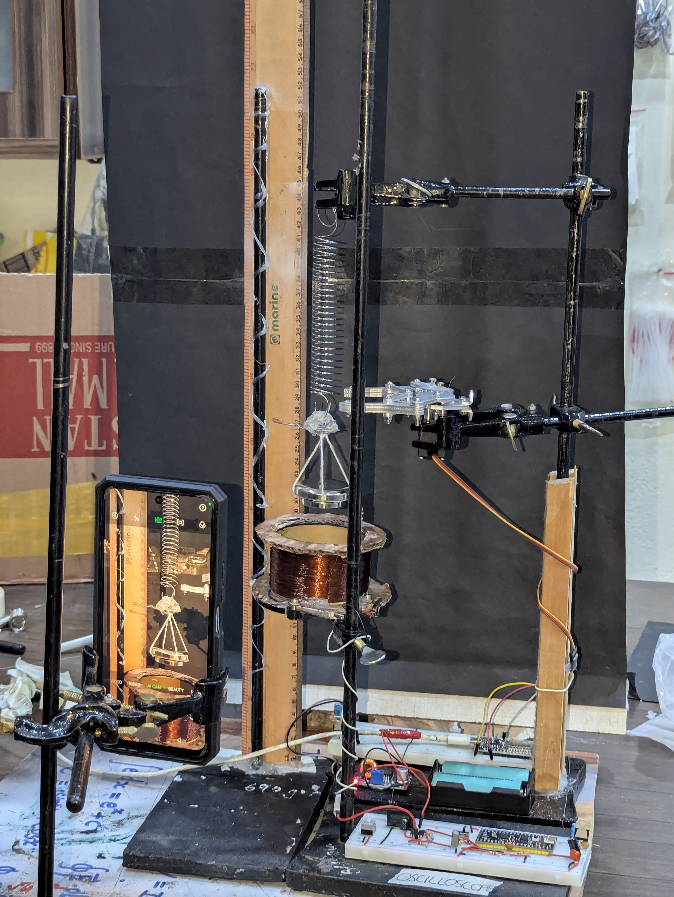
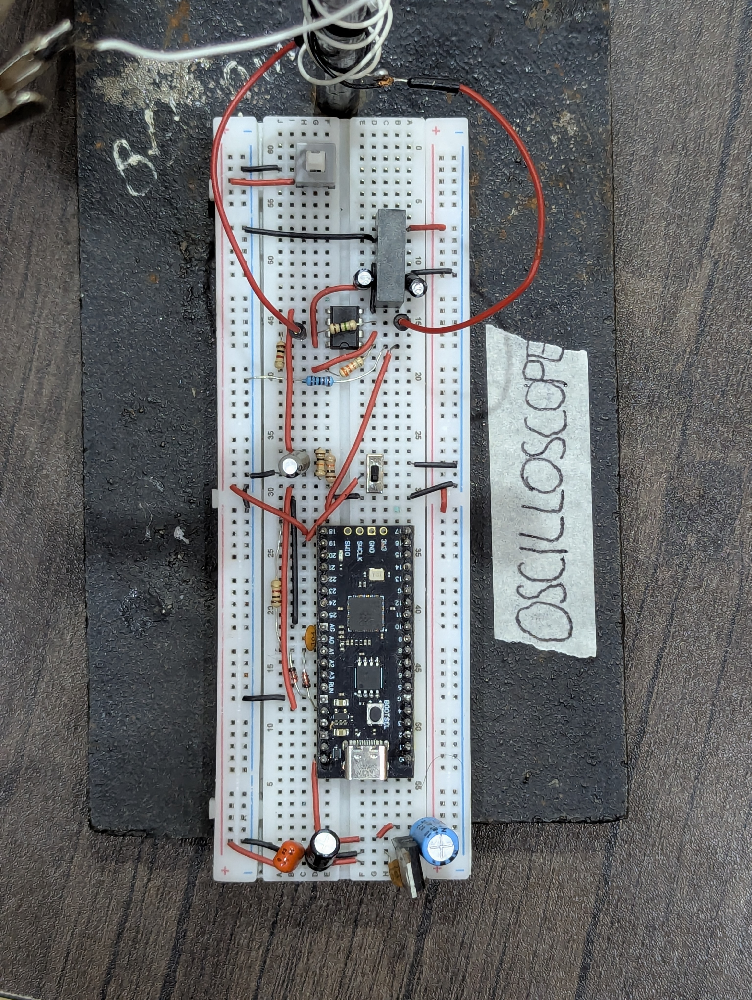
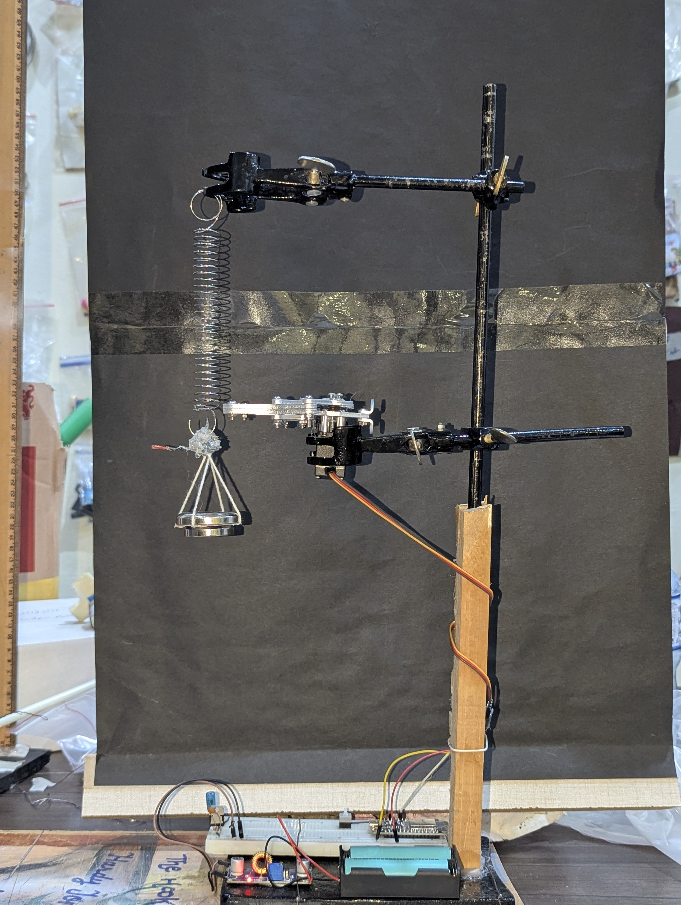

# Low-noise data acquisition system (DAQ)

Measures mV level voltages and plots them on your computer screen, built using a Raspberry Pi Pico and an OPA2134 op-amp signal conditioning stage, to record decay curves for the electromagnetic damping experiment, with a measured noise floor of ±34 µV.   

> see this project in action: https://www.youtube.com/shorts/oiMqCiaboVs

The DAQ was built because the lab's analog oscilloscope could not record the decay curves well enough and no digital oscilloscope was available.  

# Building the DAQ

A "working" version of this device is quite simple; a good version is much harder.  

Without noise-reduction measures, a constant input produces readings that jump across many quantisation steps.  

Most of the noise reduction is built in to the hardware and code. Keep all the wires short, the decoupling capacitors close to the pins, and ensure that the USB cable used to power the Raspberry Pi Pico has its +5 V bus cut off, and is instead powered through an external battery or power adapter.  

[DAQ_electric_damp.pdf](Schematics/DAQ_electric_damp.pdf)

# Damping apparatus

A neodymium magnet is attached to a spring. An aluminum claw is used to release the magnet from a constant position with an initial velocity of zero. The magnet oscillates above the coil, inducing an EMF that is measured with the DAQ.  

# Stats

### Fixed Hardware Specs
| Parameter | Specification |
| :--- | :--- |
| **ADC Bit Depth** | 12-bit (4,096 levels) |
| **Reference Voltage** | +3.3V DC |
| **Virtual Ground Bias** | +1.65V DC |
| **ADC Pin Step Resolution (LSB)** | 0.806 mV |

### Configurable Specs (35× Gain Reference Setup)
| Parameter | Specification (@ 35× Gain) | Formula for Any Gain ($A_v$) |
| :--- | :--- | :--- |
| **Hardware Gain ($A_v$)** | 35x | User-Configurable |
| **Input Voltage Ceiling** | ±47.14 mV (94.28 mVp-p) | $\pm 1.65\text{V} / A_v$ |
| **Effective Coil Resolution** | 0.023 mV (23.03 μV)* | $0.806\text{mV} / A_v$ |
| **Active Noise Floor Uncertainty** | ±0.034 mV (±34 μV) | Measured noise floor |
| **Signal-to-Noise Ratio (SNR)** | ~62.84 dB | 20 * log10(Voltage Ceiling / Noise Floor) |

*The logged data actually sit on a 23.647 µV lattice (2.7% coarser); see Known issues in the main README.

# BOM (Bill Of Materials)
|Item                   |Qty.|Price (USD)|Link                                                                                                                              |
|-----------------------------|----|----------|----------------------------------------------------------------------------------------------------------------------------------|
|Breadboard                   |1   |2.21       |https://www.aliexpress.com/item/1005005239798226.html                                                                             |
|Raspberry Pi Pico             |1   |3.64       |https://www.aliexpress.us/item/3256808762485175.html                                                                              |
|NMA0515SC ±15 V DC-DC        |1   |12.69      |https://www.lcsc.com/product-detail/C7010270.html                                                                                 |
|OPA2134PA op-amp             |1   |7.25       |https://www.lcsc.com/product-detail/C1346118.html                                                                                 |
|USB type C cable             |1   |2.63       |https://www.aliexpress.us/item/3256809634860310.html                                                                              |
|9V power adapter             |1   |2.96       |https://www.aliexpress.us/item/3256807586812399.html                                                                              |
|SPDT push button             |1   |3.36       |https://www.lcsc.com/product-detail/C318869.html                                                                                  |
|LM7805 voltage regulator     |1   |0.23       |https://www.lcsc.com/product-detail/C36350857.html?                                                                               |
|Signal diode                 |1   |1.64       |https://www.aliexpress.us/item/2251832278935821.html                                                                              |
|104 ceramic capacitor        |1   |3.36       |https://www.aliexpress.us/item/3256806988809232.html                                                                              |
|220uf electrolytic capacitor |1   |0.45       |https://www.lcsc.com/product-detail/C233093.html                                                                                  |
|22uf electrolytic capacitor  |1   |0.44       |https://www.lcsc.com/product-detail/C235681.html                                                                                  |
|10uf electrolytic capacitor  |1   |0.74       |https://www.lcsc.com/product-detail/C235887.html                                                                                  |
|1M ohm resistor              |1   |0.99       |https://www.aliexpress.us/item/3256811581264023.html                                                                              |
|35k ohm resistor             |1   |0.99       |https://www.aliexpress.us/item/3256811581264023.html                                                                              |
|10k ohm resistor             |1   |0.99       |https://www.aliexpress.us/item/3256811581264023.html                                                                              |
|1k ohm resistor              |1   |0.99       |https://www.aliexpress.us/item/3256811581264023.html |

Total (USD): $45.56

Prices are per pack. Quantities are not a full per-board count; see the schematic (`Schematics/DAQ_electric_damp.pdf`) for the complete part list (it uses an SPST switch).

# Notes
The Muino serial plotter (a Visual Studio Code extension) was mostly used to display the data.
A custom serial plotter (`Code/Live Plotter/serial_plotter.py`) was written by Hardaysh Kumar.

Built by Umer Farooq.

