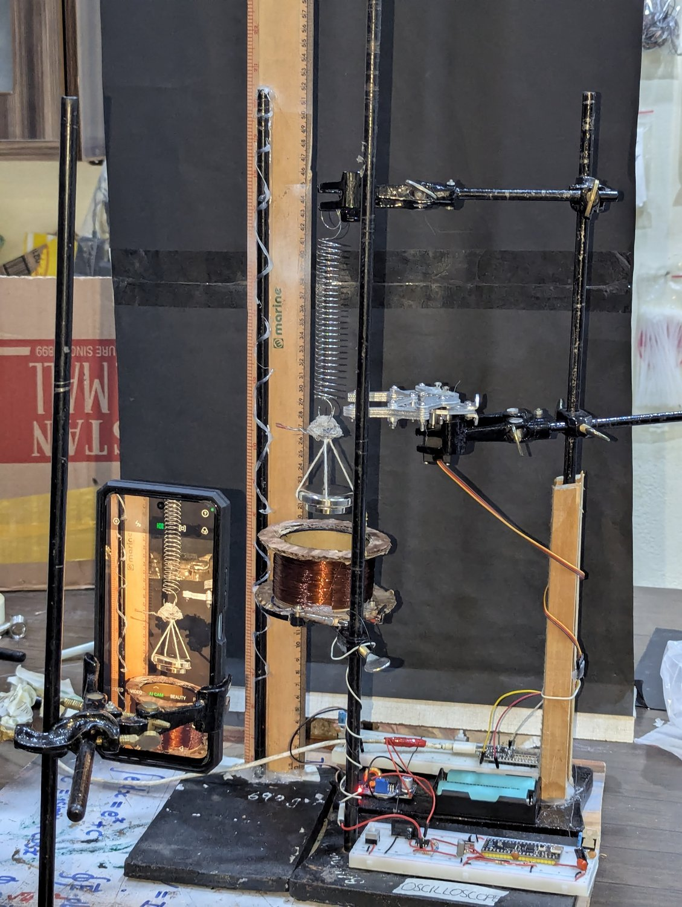
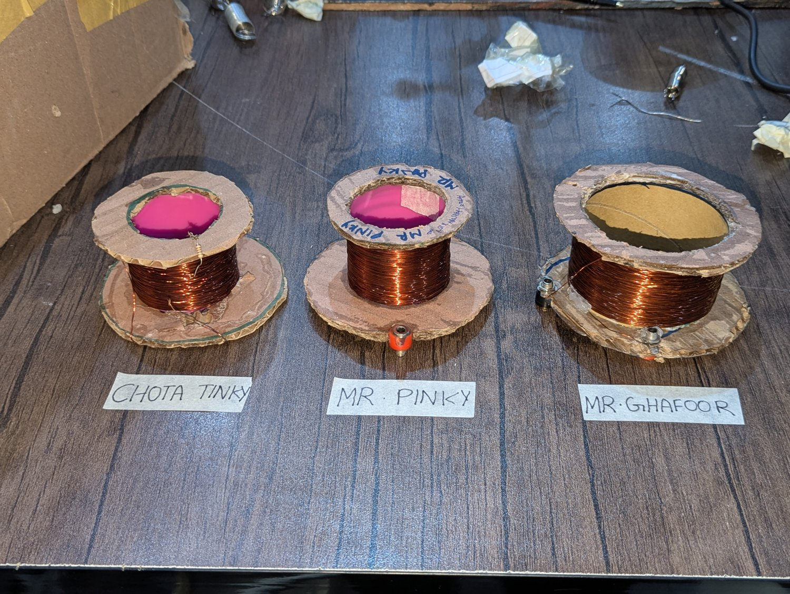
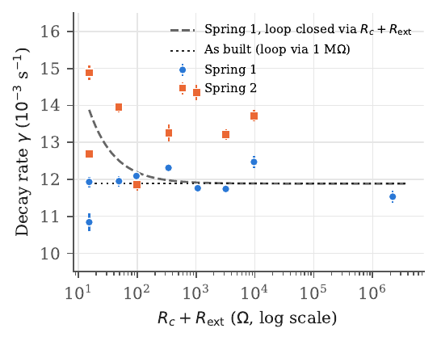
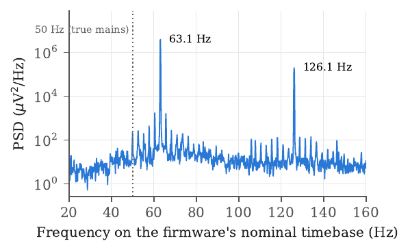
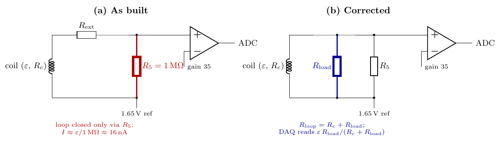

# No current, no braking: electromagnetic damping of a magnet–spring oscillator

**Hassan Tariq Malik** (lead and corresponding author, [ORCID 0009-0001-3749-090X](https://orcid.org/0009-0001-3749-090X)) · co-authors: Hardyesh Kumar and Muhammad Umer Farooq · supervised by M. Sanan Qureshi, Dr Sadia Manzoor and Dr Pervez Hoodbhoy
*The Black Hole Science Internship Programme 2026, Islamabad*

This repository holds the paper, the raw data, the low-cost data-acquisition system (DAQ) hardware and firmware, and the analysis code needed to reproduce every number and figure.

📄 **Paper:** [`paper/Hassan_Tariq_Malik_2026_No_Current_No_Braking.pdf`](paper/Hassan_Tariq_Malik_2026_No_Current_No_Braking.pdf) (APA 7 referencing) · LaTeX source in [`paper/`](paper)

<p align="center"> </p>

## The result in one paragraph

A magnet oscillating on a spring above a coil should be braked by the current induced in the coil, and the braking should fall as 1/R when you add resistance to the coil circuit. We built a US$43 Raspberry Pi Pico DAQ to measure this. **The damping did not change at all between 15 Ω and 2.2 MΩ.** The cause was the measurement circuit: the coil was closed only through the amplifier's 1 MΩ bias resistor, so about 16 nA flowed and the electromagnetic damping was a few millionths of the total. Separately, **the 50 Hz mains hum in the data showed up at 63 Hz**: the firmware's sampling loop could not keep its 10 µs schedule, so every timestamp was 26% too short. The correction agrees with independent video timing, and with the spring constants if two spring labels were swapped.

<p align="center"> </p>

## Lessons for instructors

1. Before blaming the physics, compute the current your circuit actually allows, *I* = ε / *R*<sub>loop</sub>.
2. A high-impedance input on a coil measures the EMF but brakes nothing. Give the braking current a known, low-resistance path.
3. Don't trust a microcontroller's assumed sample rate. The 50/60 Hz hum already in your data is a free clock.
4. Run an open-coil versus shorted-coil control, and check that the predicted effect exceeds your run-to-run scatter, before collecting a full data set.
5. Compare the early and late halves of each decay. A single exponential fit can hide amplitude-dependent losses.

<p align="center"></p>

## Repository layout

| Folder | Contents |
|---|---|
| `paper/` | Manuscript (`main.tex`, `references.bib`, `main.pdf`) and all figures, including the TikZ sources for the circuit and block diagrams |
| `data/` | Raw DAQ dumps for every run (`spring_*/coil_*/<R_ext>/…csv`) plus screenshots taken at the time. Each line is `time_us,emf_uV`. **Timestamps are nominal; multiply by 1.261 for true time** (see paper, Lesson 2) |
| `analysis/` | `run_all.sh` reproduces everything. `fit_decay.py` is the original peak-based fit; `round2/` holds the final fundamental-band Hilbert estimator, the alternative estimators and the significance tests; `clock_cal.py` is the mains-hum clock calibration. `final_table.csv` and `final_stats.json` are the outputs |
| `code/` | DAQ firmware (`main.cpp`, Raspberry Pi Pico), servo release (`claw.cpp`, ESP32), live serial plotter (`serial_plotter.py`) |
| `hardware/` | KiCad schematics (PDF), photos, and the original [DAQ build guide and bill of materials](hardware/DAQ_BUILD_GUIDE.md) |
| `reviews/` | The internal review: four independent referee reports (physics, statistics, electronics, editor), a cross-examination round, and a blind final referee |
| `docs/img/` | Images used in this README |

## Reproduce the results

```bash
pip install numpy scipy matplotlib
./analysis/run_all.sh      # about 5 minutes; writes analysis/final_*.{csv,json} and paper/figs/*.pdf
cd paper && latexmk -pdf main.tex    # needs TeX Live with apa7, biblatex-apa, biber, circuitikz
```

## Key numbers (spring 1, clock-corrected)

| Quantity | Value |
|---|---|
| Decay rate γ (8 runs, 15 Ω–9.6 kΩ) | (11.9 ± 0.5) × 10⁻³ s⁻¹ |
| Quality factor Q | 551 ± 24 |
| Oscillation frequency | 2.08 Hz |
| Predicted EM share if the loop were closed via the coil | ≈ 17 % (9–25 %) |
| Fitted 1/R coefficient *c* | (−0.011 ± 0.006) Ω s⁻¹ vs +0.030 predicted (disfavoured at 2.3–3σ) |
| DAQ clock factor from mains hum | 1.261 ± 0.013 |
| DAQ input noise (pre-release, rms) | 29–88 µV, median ≈ 48 µV |

## Known issues and recommended fixes

- **Open-loop coil.** The coil returns only through R5 (1 M) to the 1.65 V node, so the loop current is about 16 nA and a series R_ext does nothing. Fix: put R_load across the coil terminals (Kelvin connection), or feed the coil into a transimpedance input (coil and R_ext between 1.65 V and the inverting input, R_f in feedback).
- **Timebase.** The loop cannot sustain 10 us, so the real block period is about 1.26x the nominal 500 us. Do not write `t = i*Output_Interval`. Record `micros()` per block, or use RP2040 free-running ADC with DMA at a fixed `adc_set_clkdiv`. Check with mains hum (50 Hz should appear at 50 Hz).
- **Truncating average.** `tempStorage/Oversample_Factor` is integer division, so resolution stays at 1 LSB with a -0.5 LSB bias. Store the 32-bit sum, or divide in float.
- **Rails and clamps.** The +/-15 V op-amp output can reach about +/-13.5 V and drive the ADC pin through R6 = 1 k and silicon diodes. Use a single-supply rail-to-rail op-amp (3.3 V), BAT54S Schottky clamps and R6 >= 4.7 k.
- **R3.** The schematic says 34 k (G = 35); the BOM says 35 k (G = 36). Measure G with a known 10 mV input.
- **Scale constants.** Logged data sit on a 23.647 uV/code lattice; the repo constants (3.3, 4095, 35) give 23.025 uV. Commit the flashed firmware. Using LSB = 3.3/4096/35 = 23.019 uV, published EMF is about 2.7% high.
- **ADC DNL.** RP2040-E11 gives DNL spikes near codes 512, 1536, 2560 and 3584. Check code histograms or exclude those codes.

### Corrected sampling loop

```cpp
// RAM: 8 B/sample -> keep Max_Samples <= 25000 on the RP2040
uint32_t sumStore[Max_Samples], tStore[Max_Samples];
uint32_t acc = 0, n = 0, count = 0, t0 = micros(), next = t0;
while (digitalRead(BUTTON_PIN) == LOW && count < Max_Samples) {
  if ((int32_t)(micros() - next) >= 0) {
    next += Sample_Interval;
    acc += analogRead(ADC_PIN);
    if (++n == Oversample_Factor) {
      sumStore[count] = acc;            // full-precision sum
      tStore[count++] = micros() - t0;  // real time
      acc = n = 0;
    }
  }
}
// output: code = sumStore[i] / (float)Oversample_Factor;
// V = (code / 4096.0f * VS - VREF) / GAIN
```

All of these were found after the data were taken; the paper's numbers use the logged data as-is and quote these as uncertainties.

## Credits and licence

- The DAQ hardware, firmware and original repository were built by the team during the internship; this repository continues [Umerr7/electromagnetic-damping-daq](https://github.com/Umerr7/electromagnetic-damping-daq) with its full commit history.
- The custom serial plotter with Butterworth filtering is by Hardyesh Kumar.
- Analysis and manuscript editing were assisted by an AI tool (Claude, Anthropic), as disclosed in the paper; the authors checked all results.
- Code and hardware are released under the MIT licence (see `LICENSE`). Data and paper text: CC BY 4.0.

**Contact:** Hassan Tariq Malik, hassantariq102938@gmail.com
